<picture>
  <source media="(prefers-color-scheme: dark)" srcset="./dark_mode.svg">
  
</picture>

  
  
  
  
  
  

<picture>
  <source media="(prefers-color-scheme: dark)" srcset="./dist/snake-dark.svg">
  
</picture>

  <a href="mailto:bohodirovjavhar@gmail.com">email</a> &nbsp;·&nbsp;
  <a href="https://t.me/javxarr">telegram</a> &nbsp;·&nbsp;
  <a href="https://linkedin.com/in/javhar-bokhodirov-636bb52ab">linkedin</a>

